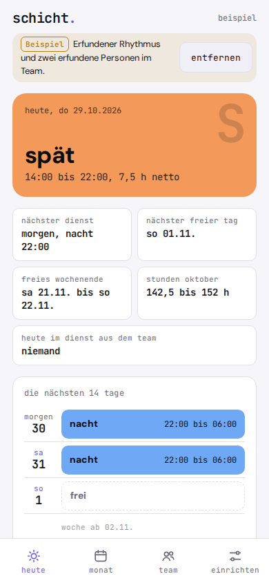
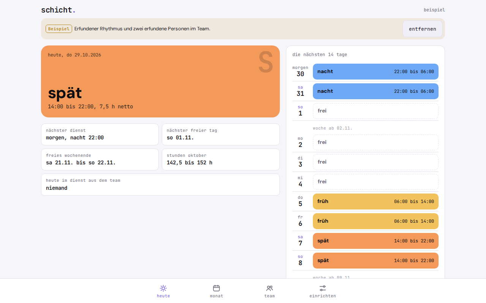

# schicht.

**Which shift am I on, on March 14?** schicht. tells you, once you have entered your pattern.

schicht. is a shift calendar for rotating shift work: early, late and night shifts, days off and vacation, team view, shift swaps and calendar export. It runs offline in the browser as a PWA, with no account and no ads, and everything stays on your phone.

   

**Try it:** https://gedachtgemacht.github.io/schicht/ (works in any phone browser, install via "Add to Home Screen")

The app interface is in German.

If you work rotating shifts, you want to know quickly what a day holds, when the next free weekend is and how many nights this month has. Shift calendar apps often show ads for this, want an account, or put patterns, calendar export and statistics behind a pro purchase or a subscription. schicht. is a shift calendar without any of that: you enter your repeating pattern, the calendar shows early, late, night, off and vacation, and a file brings the schedule into your device calendar.

Plain arithmetic, no AI, no server. Everything stays on your phone.

<p align="center">
  
  
</p>

## Why

Paid shift calendar apps cost roughly 3 to 10 euros or a subscription depending on the provider, show ads, or require an account for cloud sync. Open alternatives are rare, and those that exist are Android-only, without pattern calculation and without calendar export. schicht. does one thing: show, count and export your own shift schedule.

## Features

- **Shift types** with a short code (1 to 2 characters), name, color, start, end and break. Early, late and night are preset. `frei` ("off") and `urlaub` ("vacation") are built in
- **Rotation** (pattern): a sequence of 1 to 56 days and a start date for day 1. Five templates for common rotations to get started, then pick a shift and tap days, also in the middle of the sequence. Plus a preview of the next 14 days
- **Today at a glance:** your shift in large type in its color, next shift, next day off, next free weekend, hours this month, who from the team is on duty today, and the next 14 days as a list
- **Month calendar:** each day in the color of its shift, today marked, past days faded, month forward and back, jump to today
- **Exceptions:** tap a day and set a different shift type, `frei` or `urlaub`. Marked with a dot in the calendar, can be reset one by one
- **Monthly summary:** count per shift type, vacation and days off, working hours as a range (net with break to gross without break)
- **ICS export** for your device calendar: choose the period, at most 24 months, one event per working day, vacation as an all-day event, no events for days off
- **Team in the app:** add colleagues with name and rotation (`wie mein rhythmus` ("same as my rotation"), then shift the start date), all schedules side by side in the week view. No link, no account, no server
- **Shift swap in two taps:** tap a shift, `tauschen` ("swap"), tap the other person's shift, confirm. Both schedules change at once, also on different days and between two other people. Giving a shift away without taking one back works directly from the day sheet. Every swap can be undone as long as nothing has changed on those days since
- **Optional across devices:** if someone uses schicht. on their own phone, you send your schedule as a link. Whoever opens it has you in their team. A swap can also be sent as a request link, the answer comes back as a link, and schicht. checks first whether the schedule still matches
- **Backup** of all data as a JSON file including the team, import with validation; if the file is broken, nothing changes
- **Example** on first start with two made-up people in the team, marked as `Beispiel` ("example") and removable with one click
- Light and dark mode, works offline, installable as an app

Deliberately left out: account, server and automatic sync (that would contradict the principle that everything stays on your device), roster planning by employers, approval by a manager, checks of rest periods or labor law, pay and bonus calculation, public holidays, pattern changes from a date onwards, ICS import, reminders.

## Privacy

Nothing leaves your device. schicht. has no server, no account, no analytics, no ads and loads nothing from the network, not even fonts. Pattern, exceptions, shift types and the people in your team are stored only in your browser's local storage (`localStorage`). Exports, backups and team links are only created when you trigger them yourself, and they only go where you send them.

Because the data lives only in the browser: if you clear the site data, your schedule is gone too. Make a backup now and then.

Team links contain your name, your shift types, your pattern and your exceptions from about two months back to a bit more than a year ahead. The data sits in the part of the address after `#`, which the browser never sends to the web server. It does travel through whatever channel you choose (messenger, email), and anyone with the link can read the schedule. Share it only with your team. The links are not signed: schicht. checks structure and consistency, but cannot prove who created a link.

## Install

schicht. is a static web app. There is no build step and there are no dependencies.

1. Put the folder on any static host (your own web space, GitHub Pages, Netlify, a Raspberry Pi). Installing it as an app needs HTTPS.
2. Open the address in your phone's browser.
3. In the browser menu choose **Zum Startbildschirm hinzufügen** ("Add to Home Screen"). After that schicht. starts like an app and also works without a network.

Test locally:

```
python3 -m http.server 8000
```

Then open `http://localhost:8000` in your browser.

## How the math works

The calculations are pure functions in `logik.js`, without a DOM. Calendar days are computed only via `Date.UTC`, so a daylight saving change never shifts a day.

**1. Which shift on a given day?** If the day has an exception, it applies. Otherwise `folge[index]` applies, with `index = ((days since start) mod length + length) mod length`. This way the pattern also works before the start date.
Example with `F F S S N N - - - -` from 5 Jan 2026 (F = early, S = late, N = night, - = off): 9 Jan is 4 days after the start, index 4, so `N`. 1 Jan is 4 days before, index 6, so off.

**2. Duration.** Duration = (end minus start + 24 h) mod 24 h. If start and end are equal, the shift counts as 24 h. Net = duration minus break. End less than or equal to start means: ends the next day. A shift belongs to the day it starts.

**3. Monthly summary.** Counted per shift type, plus vacation and off. Hours are a range: low end net (with break), high end gross (without break). Vacation and days off count no hours.
Example January 2026 with the pattern above: 18 working days, gross 18 × 8 h = 144 h, net 18 × 7.5 h = 135 h. Shown as `135 bis 144 h` ("135 to 144 h").

**4. ICS file.** One `VEVENT` per working day in local time without a time zone, for night shifts with the end on the next day. Vacation becomes an all-day event. The UID is fixed (`datum-kürzel@schicht`), line endings are CRLF, long lines are folded at 75 octets.

**5. Team links.** A link is `adresse#t=` plus JSON in UTF-8, encoded as base64url without `=`. Types: `plan` (your schedule), `tausch` (swap request plus your schedule), `antwort` (accepted or declined plus the responder's schedule). Every link is fully validated before it is applied. An older schedule never overwrites a newer one.

**6. Swap.** Max has `F F S S N N - - - -` from 5 Jan 2026, Erika the same pattern from 10 Jan 2026. Max gives away 6 Jan (early) and takes Erika's 12 Jan (late) in return. Afterwards: Max is off on 6 Jan, late on 12 Jan, January `F` 5, `S` 7, `N` 6, still `135 bis 144 h`. Erika is early on 6 Jan, off on 12 Jan, January `F` 8, `S` 5, `N` 6, still `142,5 bis 152 h`. If the other person's shift type does not exist in your own schedule (same times), it is created.

**7. Swap in the app.** Same calculation as 6, just on both schedules at once. schicht. remembers which exceptions applied on both days before and after. `rückgängig` ("undo") restores the previous state, but only if both schedules on those days still look exactly as they did right after the swap.

**8. Free weekend.** The search starts from the next Saturday (on a Saturday itself, from today) and finds the first Saturday where Saturday and Sunday are both off or vacation, at most one year ahead. With the pattern above and today being 5 Jan 2026, that is 31 Jan.

**Limits.** A team in the app only knows what is entered on this device. A swap changes the schedules here, not on the other people's phones. Schedules from other devices are snapshots and only get updated when someone sends their link again. If a person accepts but the answer never arrives, the swap exists only on their side. The summary uses planned times. A night shift across a daylight saving change really lasts one hour more or less. Changing the pattern or start date also changes the past. Calendar apps behave differently when the same events are imported again: delete the old events before a new import.

Tests run with Node, without a browser and without packages:

```
node --test test-calc.js
```

## License

GNU Affero General Public License v3.0 (AGPL-3.0), see `LICENSE`.

**Deutsch:** schicht. ist ein Schichtkalender und Schichtplan für Wechselschicht (Früh, Spät, Nacht) mit Team, Schichttausch und Kalender-Export, offline, ohne Konto und ohne Werbung.

---

**gedacht.gemacht.** Small, honest software. Everything stays on your device. · [More projects](https://github.com/gedachtgemacht)
